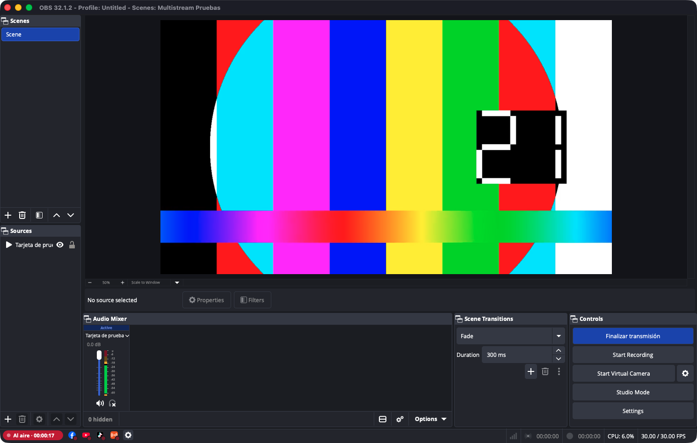

# obs-multistream

Plugin para OBS Studio que transmite a Facebook, YouTube, TikTok y una radio Icecast con un solo botón, sin copiar claves RTMP ni tokens.



- Un clic en «Iniciar transmisión» abre la ventana **Transmitir**: título, descripción, destinos y calidad, con plantillas de las transmisiones recientes.
- Cada destino es independiente: si uno se cae, los demás siguen; se puede reintentar en el mismo directo o crear uno nuevo solo ahí.
- **Radio** (Icecast, AzuraCast, Liquidsoap) en MP3, AAC, Opus, Vorbis o FLAC, sola o junto con el video. Reemplaza a programas como BUTT.
- Todo vive en la barra de estado de OBS; no agrega paneles.

**Estado:** probado en macOS con las tres plataformas y una radio AzuraCast. Windows se compila en GitHub Actions y está pendiente de probar en un equipo real.

| Documento | Contenido |
|---|---|
| [Manual](docs/manual/README.md) | Uso con capturas. |
| [Notas técnicas](docs/estado-implementacion.md) | Decisiones, pruebas y cómo desplegar tus propias credenciales. |
| [Contrato Streamlabs](docs/contrato-streamlabs.md) | Protocolo observado de Streamlabs → TikTok LIVE. |

## Compilar

- macOS: `./scripts/build-macos.sh` y `./scripts/install-macos.sh` (con OBS cerrado).
- Windows: `cmake --preset windows-x64` y `cmake --build --preset windows-x64`.
- Linux: `./scripts/build-linux.sh` y `./scripts/install-linux.sh` (con OBS cerrado). Instala en `~/.config/obs-studio/plugins/obs-multistream`. Hace falta OBS Studio 31 o más reciente (no Flatpak, que no carga plugins externos), Qt 6 (base, base-private y svg), libcurl, libsimde, FFmpeg (libavcodec, libavformat y libavutil) y libsecret-1.

Las credenciales de tus apps de Google y Meta van en `local-config.cmake` (fuera de git) o como `-D` al configurar:

```cmake
set(MULTISTREAM_GOOGLE_CLIENT_ID "...")
set(MULTISTREAM_GOOGLE_CLIENT_SECRET "...")
set(MULTISTREAM_META_BROKER_URL "https://...")
```

Para compilar en GitHub Actions desde un fork, definí los secretos `MULTISTREAM_GOOGLE_CLIENT_ID` y `MULTISTREAM_GOOGLE_CLIENT_SECRET` y la variable `MULTISTREAM_META_BROKER_URL`.

## Pruebas

`tests/e2e` maneja OBS por obs-websocket contra receptores locales (mediamtx para RTMP y un receptor Icecast propio). `tests/e2e/capture_manual.py` regenera las capturas del manual en modo demostración, sin cuentas reales.
