# Manual de Multistream

Multistream transmite lo que tenés en OBS a Facebook, YouTube, TikTok y una radio Icecast a la vez, con un solo botón. No hace falta copiar claves RTMP: cada plataforma se conecta una vez con su cuenta y el plugin crea los directos por vos.

> Las capturas usan cuentas de demostración.

## 1. Dónde está

Multistream vive en la **barra de estado de OBS**, abajo a la izquierda: un ícono por plataforma, el de la radio (si está configurada) y un engranaje.

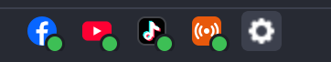

El punto junto a cada ícono indica su estado:

| Indicador | Significa |
|---|---|
| Punto verde | Listo para transmitir |
| Círculo vacío gris | Sin cuenta conectada |
| Anillo rojo | Enviando señal, esperando que la plataforma confirme |
| Punto rojo | Al aire |
| Triángulo amarillo y texto | Necesita tu atención |

**Clic** en cualquier ícono abre la ventana de estado. **Clic derecho** muestra las acciones rápidas de ese destino (abrir el directo, reintentar, conectar otra cuenta).

## 2. Conectar las cuentas (una sola vez)

Abrí la ventana de estado con clic en un ícono y usá **Conectar** en cada plataforma. Se abre el navegador para autorizar; al volver, el destino queda en **Listo**.

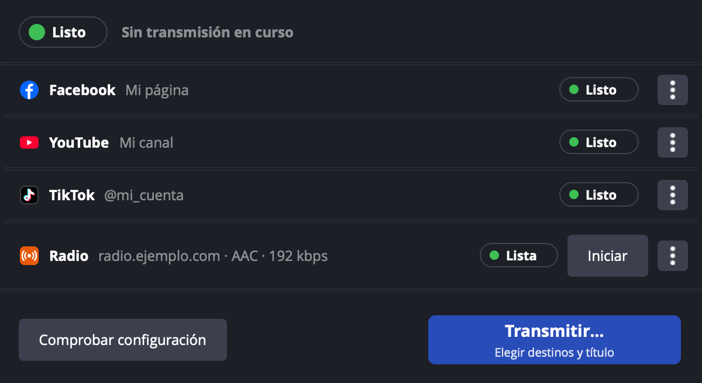

- **Facebook**: después de autorizar, elegí la página donde se transmite.
- **YouTube**: usa el canal de la cuenta autorizada.
- **TikTok**: se conecta a través de Streamlabs; la cuenta necesita acceso a LIVE.

## 3. Transmitir

Presioná **Iniciar transmisión** en los controles de OBS. En lugar de salir directo, se abre la ventana **Transmitir**:

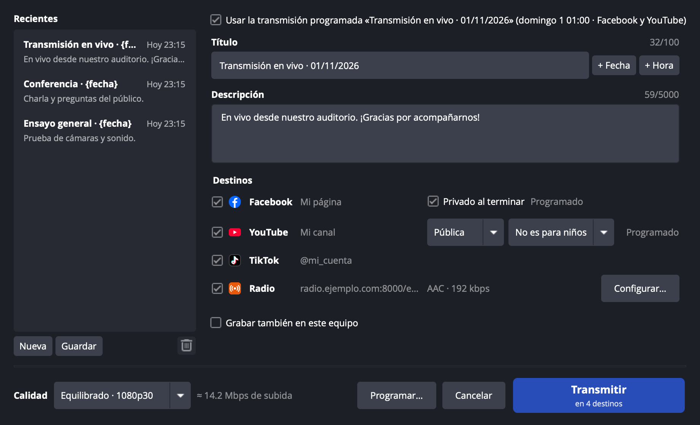

1. **Recientes** (izquierda): cada transmisión queda guardada. Elegí una y se completan título y descripción. **Guardar cambios** actualiza la que tenés seleccionada; **Nueva** empieza en blanco.
2. **Título**: `+ Fecha` y `+ Hora` insertan `{fecha}` y `{hora}`, que se reemplazan al transmitir. Debajo ves cómo se va a publicar.
3. **Descripción**: se publica en YouTube y Facebook.
4. **Destinos**: marcá dónde transmitir, incluida la radio. Cada uno tiene sus opciones en la misma fila:
   - YouTube: visibilidad y si el contenido es para niños (YouTube lo exige; no se elige por vos).
   - Facebook: **Privado al terminar** deja el video en la página pero visible solo para administradores.
   - TikTok: muestra solo los primeros 32 caracteres del título; si lo recorta, te avisa.
5. **Grabar también en este equipo**: inicia la grabación de OBS junto con la transmisión y la detiene al terminar, con la carpeta y el formato que tenga configurados OBS.
6. **Calidad**: con la subida estimada para los destinos elegidos.

Presioná **Transmitir** (o Enter). Si falta algo, el botón dice qué.

Si hay una transmisión programada para las próximas horas, arriba aparece **Usar la transmisión programada** ya marcado: completa título y descripción y transmite en los directos que ya compartiste (ver [Programar con anticipación](#7-programar-con-anticipación)).

## 4. Durante la transmisión

La barra muestra el tiempo al aire y solo los destinos de esta transmisión:

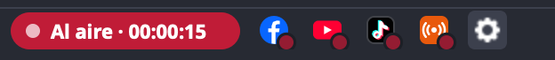

El botón de OBS pasa a **Finalizar transmisión**:

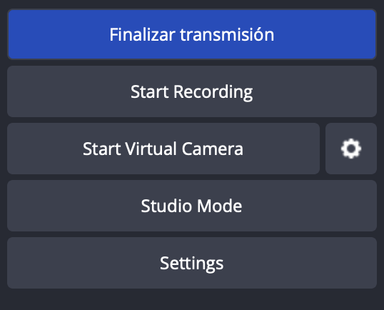

Así se ve OBS completo al aire:

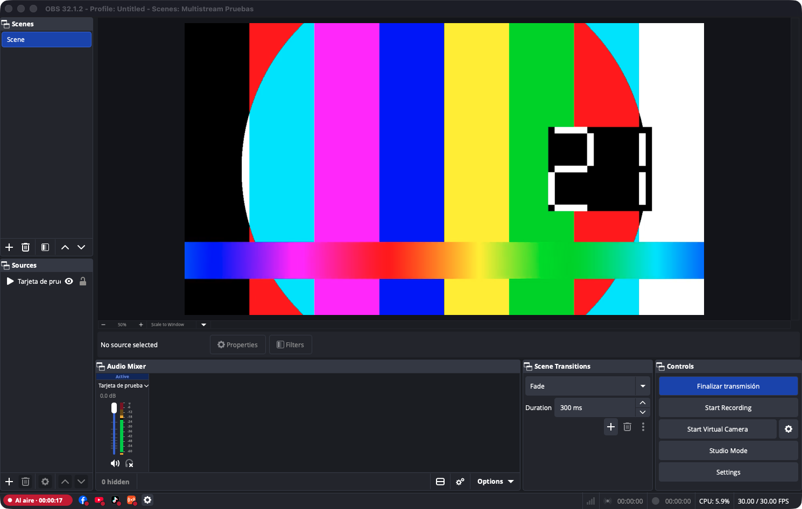

La ventana de estado muestra cada destino con lo enviado, frames perdidos y reconexiones, y un botón para abrir cada directo:

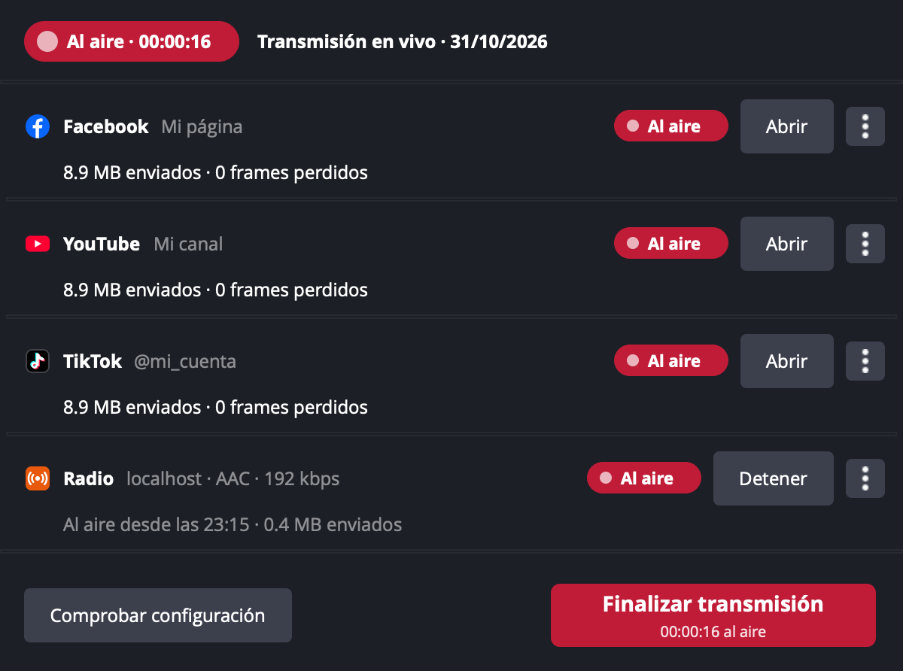

## 5. Si se cae un destino

Si una plataforma pierde la conexión, Multistream reintenta solo en el mismo directo. Si no lo logra, ese destino queda en **Sin señal** y los demás siguen al aire:

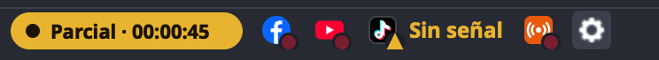

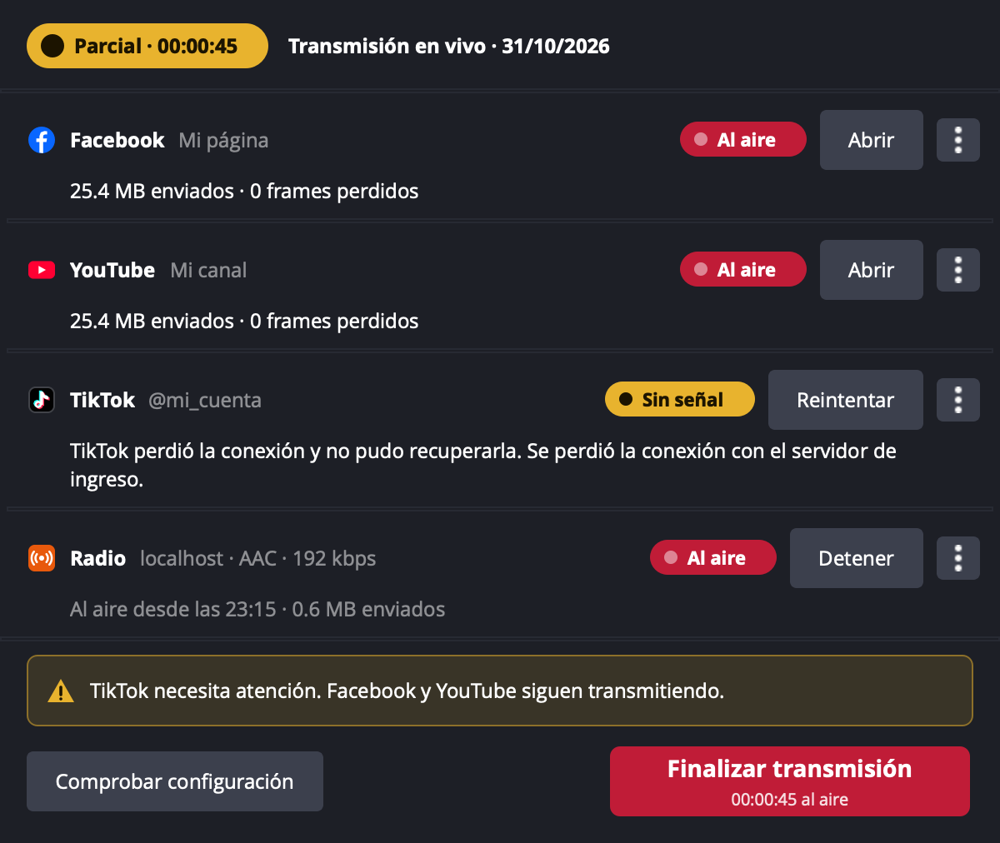

- **Reintentar** vuelve a enviar al mismo directo (los espectadores siguen en el mismo enlace).
- **Nuevo directo** (en el menú `⋮` o con clic derecho en el ícono) crea otro directo solo en ese destino y cierra el anterior. Úsalo si la plataforma ya cerró el directo.

## 6. Finalizar

Presioná **Finalizar transmisión**. Multistream pide confirmación para evitar cortes accidentales:

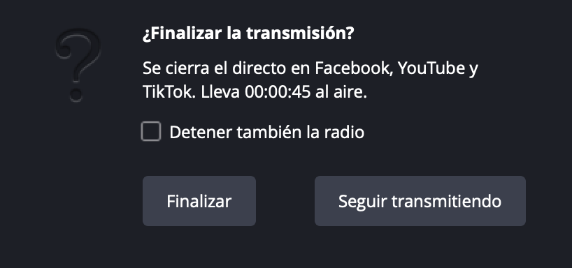

Al confirmar, cierra el directo en cada plataforma. Si alguna no responde, queda en **Cierre pendiente** con **Reintentar cierre**.

## 7. Programar con anticipación

Para compartir el enlace antes del evento (por WhatsApp o redes), creá el directo con fecha y hora desde el engranaje → **Programar transmisión…** o desde el botón **Programar…** de la ventana Transmitir.

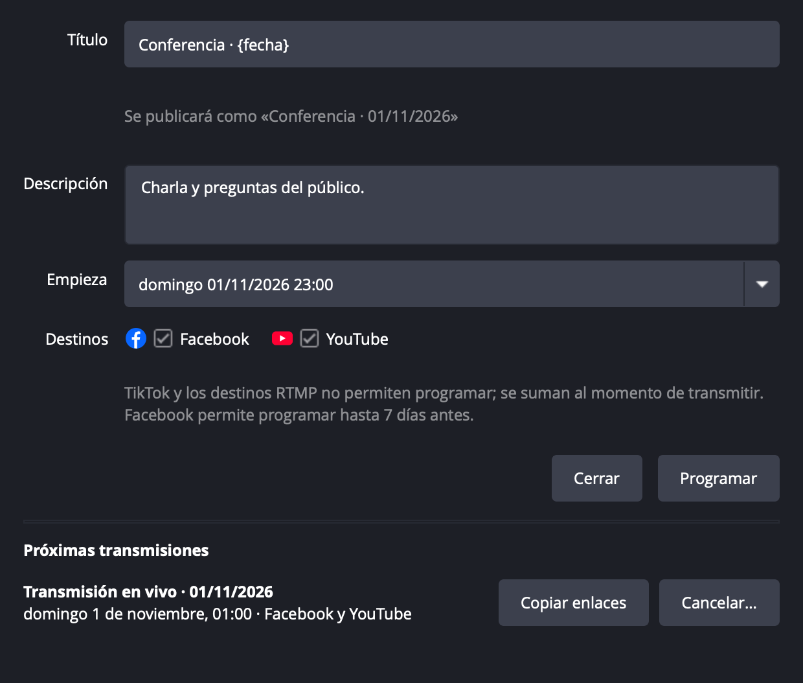

1. Título y descripción (con `{fecha}`, que toma la fecha programada) y la fecha y hora de inicio.
2. Elegí los destinos y presioná **Programar**. Los enlaces quedan copiados, listos para pegar.
3. El día del evento, «Iniciar transmisión» ofrece usar esa transmisión programada y sale al aire en esos mismos directos. Si empezás antes de la hora, el directo arranca igual.

En **Próximas transmisiones** podés volver a copiar los enlaces o cancelar una (se borra en cada plataforma). Si una transmisión programada nunca salió al aire, finalizar no la borra: sigue disponible para intentar de nuevo.

Se puede programar en YouTube. En Facebook, Meta solo permite programar a las apps que aprobó con acceso avanzado; si la tuya no lo tiene, la ventana lo avisa y programa solo en YouTube. TikTok y los destinos RTMP no permiten programar: se suman al momento de transmitir.

## 8. Otros destinos (RTMP)

Para transmitir a un servicio que no tiene integración propia (Kick, Vimeo, Twitch con clave, un servidor propio), usá el engranaje → **Agregar destino RTMP…**.

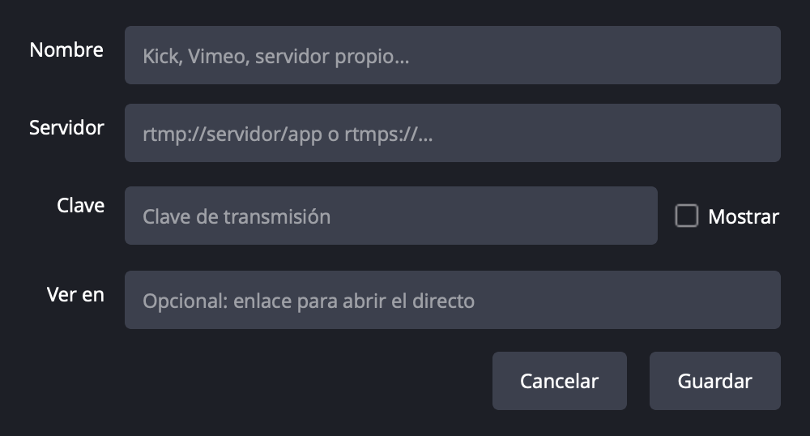

Ponele un nombre, el servidor (`rtmp://` o `rtmps://`) y la clave de transmisión; opcionalmente el enlace para ver el directo. Aparece como un destino más en la barra, en Transmitir y en la ventana de estado. Para cambiarlo o quitarlo, clic derecho en su ícono → **Editar destino…** o **Quitar destino**.

## 9. Avisos

Multistream avisa con un sonido y una notificación cuando un destino o la radio se cae, y otra vez cuando vuelve.

También vigila el audio: si la pista que se transmite lleva 20 segundos en silencio (micrófono silenciado, fuente apagada o pista equivocada), aparece **Sin audio** en la barra de estado y suena el aviso. Se retira solo cuando vuelve el sonido.

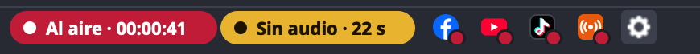

Los dos avisos se pueden desactivar desde el engranaje (**Avisos con sonido** y **Avisar si no hay audio**). Las notificaciones usan el ícono de OBS en la bandeja del sistema, si está activado en la configuración de OBS.

## 10. Radio

Multistream puede reemplazar a BUTT u otro programa de radio: envía el audio de OBS a un servidor Icecast (también AzuraCast o Liquidsoap), sola o junto con el video.

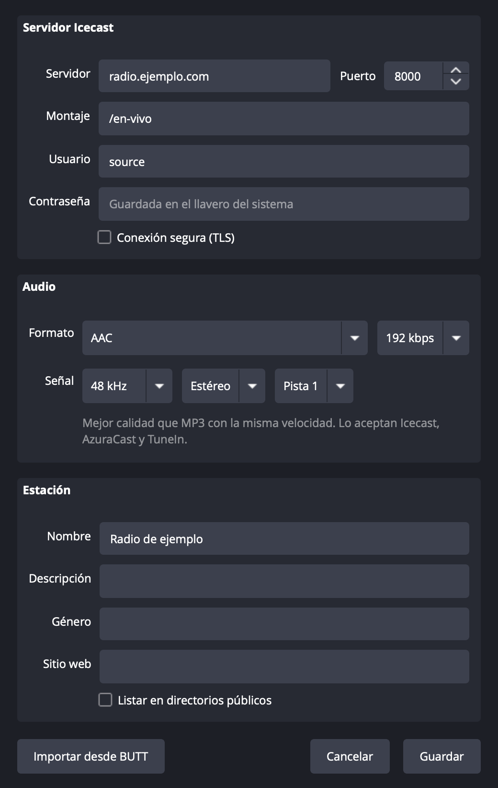

1. En el engranaje, **Configurar radio…**. Si en el equipo hay una configuración de BUTT, **Importar desde BUTT** copia servidor, contraseña, formato y datos de la estación.
2. **Formato**: MP3 (el más compatible), AAC (mejor calidad con la misma velocidad), Opus (la mejor calidad por kbps), Vorbis o FLAC (sin pérdida). Si tu servidor vuelve a codificar, como AzuraCast, conviene enviar en alta calidad: AAC 256 o Opus 192.
3. **Pista**: la pista de audio de OBS que se envía. Usá otra pista si querés una mezcla distinta para la radio.
4. La contraseña se guarda en el llavero de macOS o en el Administrador de credenciales de Windows.

Para salir al aire, marcá **Radio** en la ventana Transmitir, o usá clic derecho en el ícono de la radio → **Iniciar la radio** para transmitir solo audio. La radio es independiente: si finalizás el video, la confirmación pregunta si también querés detener la radio. Si se corta la conexión, reconecta sola; si el servidor rechaza la contraseña, lo avisa y no insiste.

## 11. Si OBS se cerró a la fuerza

Al volver a abrir OBS, la barra muestra **Emisión sin cerrar**. Abrí la ventana de estado y elegí **Cerrarla ahora**. Hasta resolverla no se puede iniciar otra transmisión.

## 12. Opciones

El engranaje de la barra tiene:

- **Transmitir… / Finalizar transmisión…**
- **Estado de la transmisión…**
- **Iniciar / Detener la radio** y **Configurar radio…**
- **Programar transmisión…** y **Agregar destino RTMP…**
- **Avisos con sonido** y **Avisar si no hay audio**
- **Iniciar desde el botón de OBS**: desmarcalo si querés que «Iniciar transmisión» vuelva a usar el servicio configurado en OBS.
- **Comprobar configuración…**: codificador, cuentas conectadas y subida necesaria.

También podés asignar atajos en *Ajustes → Atajos de teclado*: «Multistream: transmitir a los destinos elegidos» y «Multistream: finalizar transmisión».
